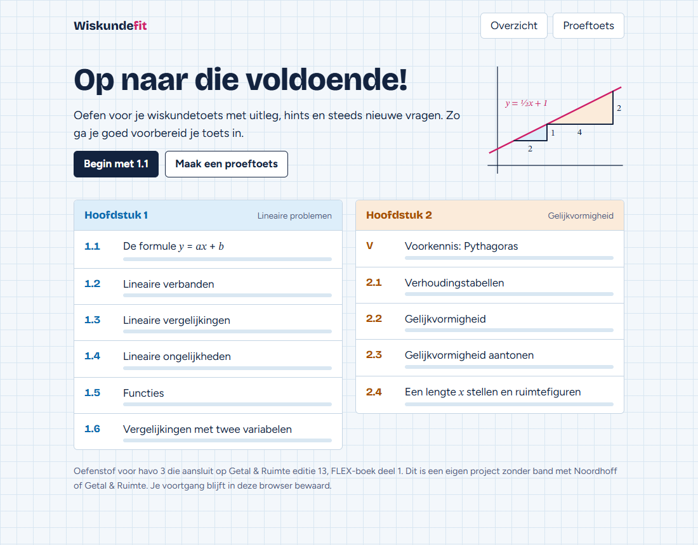

# Wiskundefit

Interactieve oefensite voor de wiskundetoets over hoofdstuk 1 (lineaire problemen) en hoofdstuk 2 (gelijkvormigheid) van havo 3. De site sluit aan op _Getal & Ruimte_, editie 13, FLEX-boek deel 1.



## Wat de site doet

- **Uitleg per paragraaf**, met voorbeelden die stap voor stap verschijnen en interactieve onderdelen, zoals schuifjes voor `a` en `b` in `y = ax + b`.
- **Oefenvragen** die elke keer nieuwe getallen krijgen. Er zijn 65 soorten vragen, met hints, uitwerkingen en gerichte feedback op veelgemaakte fouten.
- **Proeftoetsen** van 10 tot 30 vragen, met aan het eind een score per paragraaf en alle uitwerkingen.
- **Video's** per paragraaf, als links naar YouTube.
- **Voortgang** per vaardigheid, bewaard in de browser. Er is geen server en er is geen account nodig.

## Snel beginnen

Je hebt [Node.js](https://nodejs.org) 20 of nieuwer nodig.

```sh
npm install
npm run dev
```

Open daarna <http://localhost:5173>. Wijzig je een bestand in `src/`, dan hoef je de pagina alleen te herladen. Open `src/index.html` niet rechtstreeks: browsers laten JavaScript-modules alleen via een webserver werken.

Bij `npm install` meldt npm mogelijk dat het installatiescript van esbuild niet is uitgevoerd. Dat is geen probleem, de build werkt ook zonder.

## Commando's

| Commando               | Wat het doet                                                     |
| ---------------------- | ---------------------------------------------------------------- |
| `npm run dev`          | Start de site lokaal, zonder bouwstap                            |
| `npm run build`        | Bouwt `dist/index.html`: de hele site in één bestand om te delen |
| `npm test`             | Maakt van elke soort vraag 500 varianten en controleert die      |
| `npm run test:browser` | Bouwt de site en klikt hem door in Edge (ongeveer 1,5 minuut)    |
| `npm run images`       | Maakt het linkvoorbeeld en het icoon opnieuw                     |
| `npm run format`       | Maakt de code netjes op met Prettier                             |

Wil je de site delen? Stuur dan `dist/index.html` door; de PNG's ernaast zijn alleen voor de online versie nodig. Dat bestand werkt zonder installatie door erop te dubbelklikken, ook zonder internet. Alleen de video's hebben een verbinding nodig.

## Online zetten

Elke push naar `main` draait de tests, bouwt de site en zet hem online via [.github/workflows/deploy.yml](.github/workflows/deploy.yml). De site staat op een Azure Static Web App met het gratis Free-plan. De workflow gebruikt het GitHub-secret `AZURE_STATIC_WEB_APPS_API_TOKEN`, het deploy-token van die app.

## Zo zit het in elkaar

```text
src/
├── index.html              De lege pagina die styles.css en js/main.js laadt
├── styles.css              Alle opmaak, inclusief donkere modus
├── og.png                  Afbeelding voor linkvoorbeelden, gemaakt met npm run images
├── apple-touch-icon.png    Icoon voor het beginscherm, gemaakt met npm run images
├── fonts/                  De lettertypes met hun licenties
└── js/
    ├── main.js             Startpunt: kiest het scherm en verwerkt klikken
    ├── math.js             Rekenhulp: toeval, breuken, getallen schrijven
    ├── typeset.js          Zet tekst om naar wiskundezetting in HTML
    ├── figures.js          Tekent grafieken en driehoeken als SVG
    ├── answers.js          Leest en controleert antwoorden
    ├── progress.js         Bewaart de voortgang in de browser
    ├── paragraphs/         De lesstof: elk bestand is één paragraaf
    │   ├── index.js        De lijst met alle paragrafen
    │   ├── shared.js       Hulpmiddelen voor meerdere paragrafen
    │   ├── voorkennis-lineair.js  Lineaire formules
│   ├── voorkennis.js   Pythagoras
    │   └── 1.1.js … 2.4.js
    └── ui/                 De schermen
        ├── home.js         Overzicht
        ├── paragraph.js    Uitleg, oefenen en video's
        ├── exam.js         Proeftoets
        ├── question-form.js Invoervelden van een vraag
        ├── widgets.js      Schuifjes en hoekendemo
        ├── about.js        Over de site, privacy en contact
        ├── layout.js       De balk bovenaan en de voettekst
        └── state.js        Gedeelde toestand van de schermen
scripts/                    Build, ontwikkelserver, afbeeldingen en releasenotities
tests/                      Generatortests, releasecontrole en browsertest
```

De belangrijkste plek om te beginnen is een bestand in `src/js/paragraphs/`. Bovenaan staan de functies die vragen maken, onderaan de uitleg en de lijst met vaardigheden. Elke functie geeft één vraag terug, met het antwoord, een hint en de uitwerking. De schermen in `ui/` tonen die vraag alleen en weten niets van wiskunde.

In [AGENTS.md](AGENTS.md) staat hoe je een vraag of paragraaf toevoegt en welke afspraken gelden.

## Lesmateriaal

De map `lesstof/` is bewust niet opgenomen in deze repository (zie `.gitignore`). De uitwerkingen daarin zijn auteursrechtelijk beschermd materiaal van de uitgever. De site gebruikt ze alleen als naslag voor de werkwijze en notatie; de uitleg en vragen zijn zelf geschreven of worden automatisch gemaakt.

De werkwijze is vergeleken met de theorie en de voorbeelden uit het boek. De site zegt niet welke stof bij een toets hoort: dat hangt af van het boek en de docent, en de leerling kiest het zelf.

Dit is een persoonlijk project en heeft geen band met Noordhoff of _Getal & Ruimte_. De video's zijn van de YouTube-kanalen Math with Menno en Wiskunde met Bob Pruiksma.

## Licentie

De code en de zelf geschreven lesstof vallen onder de [MIT-licentie](LICENSE). Die geldt niet voor het materiaal van de uitgever of voor de video's waarnaar de site linkt. De lettertypes in `src/fonts/` vallen onder de SIL Open Font License; de teksten staan in die map.
